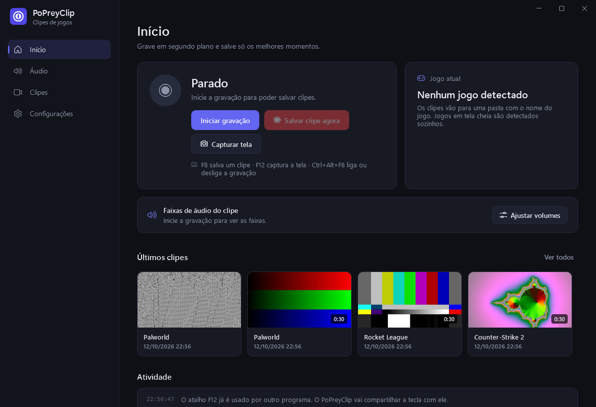
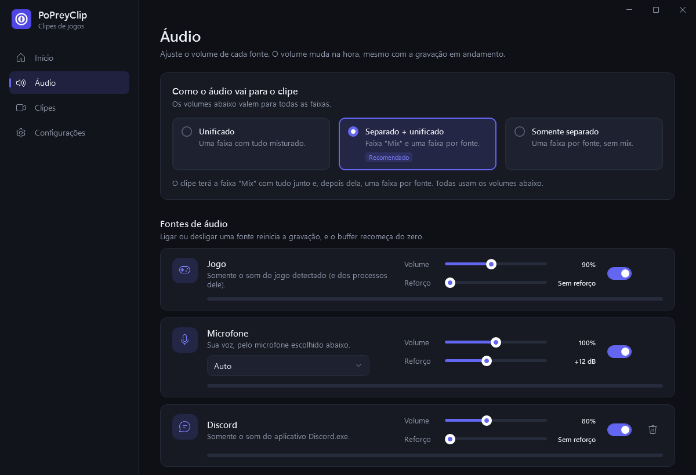
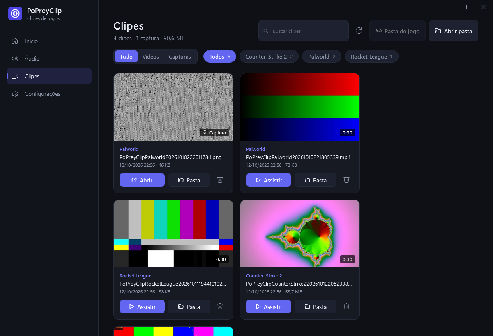

<div align="center">


# PoPreyClip

**Grave seus jogos em segundo plano e salve só os melhores momentos.**
Uma pasta para cada jogo, áudio separado por aplicativo e capturas de tela com um atalho.

[](../../releases/latest)




</div>

---

## Sumário

- [Funcionalidades](#-funcionalidades)
- [Instalação](#-instalação)
- [Como usar](#-como-usar)
- [Atalhos padrão](#️-atalhos-padrão)
- [Problemas comuns](#-problemas-comuns)
- [Compilar a partir do código](#️-compilar-a-partir-do-código)
- [Privacidade](#-privacidade)
- [Licença](#-licença)

## ✨ Funcionalidades

- 🎬 **Replay instantâneo:** enquanto você joga, o PoPreyClip grava em segundo plano e, quando você aperta **F8**, salva os últimos 30 segundos (a duração é configurável).
- 🎯 **Grava só o jogo:** filma a janela do jogo, não a tela inteira. Alt-tab, outras janelas e a área de trabalho não aparecem no clipe, e o som continua sincronizado mesmo se o jogo for minimizado.
- 💤 **Modo espera:** sem jogo aberto, o app fica parado e não gasta recursos. A gravação liga sozinha quando o jogo abre e desliga quando ele fecha.
- 👀 **Jogos e apps vigiados:** escolha qualquer janela (um jogo que não foi detectado, um emulador, um programa) para ser tratada como jogo assim que abrir.
- 📁 **Uma pasta por jogo:** o jogo aberto é detectado sozinho e cada clipe vai para `Clips\<Nome do Jogo>\`.
- 🎧 **Áudio separado por aplicativo:** jogo, microfone, Discord e qualquer outro programa viram faixas separadas no clipe, cada uma com seu volume.
- 🎚️ **Mixer de áudio:** volume de 0 a 200%, reforço de até +30 dB para microfones baixos e um limitador que evita distorção.
- 📸 **Captura de tela com F12:** imagem PNG salva em `Screenshots\<Nome do Jogo>\` e copiada para a área de transferência, pronta para colar no Discord.
- 🗂️ **Biblioteca de clipes:** miniaturas, duração, filtro por jogo, busca e botões para assistir, abrir a pasta ou excluir.
- ⌨️ **Atalhos configuráveis:** funcionam dentro do jogo, mesmo com Shift ou Ctrl segurados, e podem ser trocados nas configurações.
- 🔔 **Aviso na tela e som:** ao salvar um clipe ou uma captura, um aviso verde aparece no canto superior direito por cima do jogo, sem tirar o foco, junto com um som curto. Os dois podem ser trocados ou desligados.
- 🖥️ **Fica na bandeja:** ao fechar a janela, ele continua gravando ao lado do relógio.
- 🚀 **Inicia com o Windows (opcional):** abre sozinho ao ligar o PC, já escondido na bandeja.
- 🔄 **Atualização automática:** avisa quando sai uma versão nova e se atualiza com um clique.
- ⚡ **Leve:** usa o codificador da placa de vídeo NVIDIA quando existe e o processador nos outros casos.

<table>
  <tr>
    <td></td>
    <td></td>
  </tr>
  <tr>
    <td align="center"><b>Áudio:</b> volume e reforço de cada fonte</td>
    <td align="center"><b>Clipes:</b> tudo separado por jogo</td>
  </tr>
</table>

## 📥 Instalação

### Requisitos

- Windows 10 (versão 2004 ou mais nova) ou Windows 11, 64 bits.
- Internet na primeira vez que abrir, para o app baixar o FFmpeg (veja o passo 2).
- Placa de vídeo NVIDIA é recomendada, mas não obrigatória.

### Passo 1: baixar o PoPreyClip

1. Abra a página de [**Releases**](../../releases/latest).
2. Baixe o arquivo **`PoPreyClip.exe`**. O outro arquivo, `PoPreyClip.exe.sha256`, é usado pela atualização automática e não precisa ser baixado.
3. Coloque o arquivo numa pasta fixa, por exemplo `C:\Programas\PoPreyClip\`.

Não precisa instalar mais nada: o `.exe` já traz tudo o que o app usa, inclusive o .NET.

### Passo 2: abrir

Dê dois cliques no `PoPreyClip.exe`. O app abre em espera e começa a gravar sozinho quando você abrir um jogo.

Na primeira vez, ele baixa sozinho o [FFmpeg](https://ffmpeg.org/), o programa gratuito que faz a gravação (cerca de 110 MB, leva alguns segundos). Depois, o PoPreyClip mantém o FFmpeg atualizado junto com o app. Você não precisa instalar nada. O andamento aparece em **Configurações → Atualizações**.

> **"O Windows protegeu o computador"?** O aviso aparece porque o app não tem assinatura digital paga. Clique em **Mais informações** e depois em **Executar assim mesmo**. O código é aberto e está todo neste repositório.

Dica: clique com o botão direito no `.exe`, escolha **Enviar para → Área de trabalho (criar atalho)** e use o atalho no dia a dia.

## 🎮 Como usar

### Salvar um clipe

1. Abra o PoPreyClip. Ele fica **em espera** até um jogo abrir.
2. Abra o jogo. A gravação liga sozinha e a bolinha vermelha na barra lateral acende.
3. Aconteceu algo bom? Aperte **F8**. Os últimos 30 segundos são salvos, e um som curto e um aviso verde no canto da tela confirmam.
4. Ao fechar o jogo, a gravação desliga sozinha.

Prefere gravar o tempo todo? Desligue **Gravar só quando um jogo estiver aberto** em **Configurações → Comportamento**. Os botões **Iniciar gravação** e **Parar gravação** também funcionam a qualquer momento.

O clipe vai para:

```
C:\PoPreyClip\Clips\<Nome do Jogo>\PoPreyClip<NomeDoJogo><data e hora>.mp4
```

### Tirar uma captura de tela

Aperte **F12**. A imagem vai para `C:\PoPreyClip\Screenshots\<Nome do Jogo>\` e também fica copiada, pronta para colar com **Ctrl+V**.

### Ajustar o áudio

Na tela **Áudio**:

- **Modo das faixas:**
  - *Unificado:* uma faixa com tudo misturado.
  - *Separado + unificado (recomendado):* uma faixa "Mix" e uma faixa para cada fonte.
  - *Somente separado:* uma faixa por fonte.
- **Volume e reforço:** cada fonte (Jogo, Microfone, Discord...) tem o seu. O volume muda na hora, mesmo gravando.
- **Microfone baixo?** Suba o **Reforço**. Headsets costumam precisar de +10 a +15 dB.
- **Adicionar aplicativo:** escolha um programa aberto, como o Spotify ou o navegador, para gravar o som dele numa faixa própria.

> Os players comuns tocam só a primeira faixa (a "Mix"). Para ouvir cada faixa separada, use um editor como o **DaVinci Resolve**, o **Premiere** ou o **Shotcut**.

### Mudar a pasta, os atalhos e o vídeo

Na tela **Configurações** você troca:

- a pasta raiz dos clipes e capturas;
- os atalhos (clique no campo e aperte as teclas);
- a duração do clipe (de 5 segundos a 5 minutos);
- o que gravar: **só a janela do jogo** (padrão) ou o **monitor inteiro**;
- o codificador, os quadros por segundo, o monitor e a qualidade do vídeo;
- o aviso na tela (o do PoPreyClip, a notificação do Windows ou nenhum), em **Aviso na tela**;
- o som do clipe e o som da captura de tela, com botão **Ouvir** para testar;
- o que acontece ao fechar a janela;
- **Iniciar com o Windows**, em **Comportamento**, para o app abrir sozinho ao ligar o PC.

### Sair de verdade

Fechar a janela deixa o PoPreyClip gravando na bandeja. Para sair, clique com o botão direito no ícone da bandeja e escolha **Sair**.

### Atualizações

O PoPreyClip procura versões novas sozinho, ao abrir e a cada 6 horas. Quando sai uma, aparece um aviso no topo do app:

1. Clique em **Atualizar agora**.
2. O app baixa a versão nova, confere se o arquivo veio inteiro e se reinicia já atualizado. Leva só alguns segundos.

Você pode procurar na hora ou desligar a busca automática em **Configurações → Atualizações**.

> A atualização automática funciona a partir da versão **1.0.1**. Quem tem a 1.0.0 precisa baixar a versão nova uma vez pela página de [Releases](../../releases/latest).
>
> Se o `PoPreyClip.exe` estiver numa pasta protegida (como `C:\Arquivos de Programas`), o app abre a página de download em vez de se atualizar. Por isso a recomendação é usar uma pasta sua, como `C:\Programas\PoPreyClip\`.

## ⌨️ Atalhos padrão

| Atalho | Ação |
|---|---|
| `F8` | Salvar clipe dos últimos segundos |
| `F12` | Capturar a tela |
| `Ctrl+Alt+F8` | Iniciar ou parar a gravação |

Todos podem ser trocados em **Configurações → Teclas de atalho**.

## ❓ Problemas comuns

<details>
<summary><b>Aparece "O FFmpeg não foi encontrado"</b></summary>

O PoPreyClip baixa o FFmpeg sozinho na primeira vez que abre. Se aparecer essa mensagem, confira a internet e clique em **Procurar agora**, em **Configurações → Atualizações**. O download pode estar bloqueado por um antivírus ou firewall.
</details>

<details>
<summary><b>O clipe saiu com a tela preta, parada ou sem o jogo</b></summary>

- Se um jogo não manda imagem pela janela, o PoPreyClip percebe sozinho em alguns segundos e passa a gravar o monitor. Você também pode escolher **Monitor inteiro** em **Configurações → Vídeo → O que gravar**.
- Alguns jogos em **tela cheia exclusiva** bloqueiam a captura. Mude o modo de vídeo do jogo para **Janela sem borda** (*Borderless* ou *Tela cheia em janela*).
</details>

<details>
<summary><b>O jogo não foi detectado e o clipe foi para "Unknown Game"</b></summary>

O PoPreyClip reconhece jogos em tela cheia ou janela sem borda. Se o seu jogo não for detectado, adicione-o em **Configurações → Jogos e apps vigiados**: com o jogo aberto, escolha a janela dele na lista, confira o nome e clique em **Vigiar**. Daí em diante ele é reconhecido assim que abrir.
</details>

<details>
<summary><b>O atalho não funciona</b></summary>

Outro programa pode estar usando a mesma tecla, como o Steam, o Discord ou o overlay da NVIDIA. Troque o atalho em **Configurações → Teclas de atalho**.

Segurar Shift ou Ctrl junto (para correr ou agachar, por exemplo) não atrapalha. Alt e a tecla Windows sim, porque o Windows usa essas combinações para outras coisas.
</details>

<details>
<summary><b>Meu microfone está muito baixo no clipe</b></summary>

Na tela **Áudio**, suba o **Reforço** do microfone (+10 a +15 dB costuma bastar). O limitador evita que a voz distorça.
</details>

<details>
<summary><b>Tenho placa AMD ou Intel</b></summary>

Funciona. No modo **Automático** o PoPreyClip usa o processador para gravar. As opções AMD e Intel nas configurações ainda são experimentais.
</details>

<details>
<summary><b>O antivírus reclamou do arquivo</b></summary>

Apps que leem atalhos de teclado globais e não têm assinatura digital às vezes geram falso positivo. O código é aberto e você pode [compilar o seu próprio executável](#️-compilar-a-partir-do-código).
</details>

## 🛠️ Compilar a partir do código

Para quem quer mexer no projeto.

**Requisitos:** [.NET 10 SDK](https://dotnet.microsoft.com/download) e FFmpeg.

```powershell
git clone <url-deste-repositório>
cd popreyclip

# Rodar o app com interface
dotnet run --project src/PoPreyClip.App

# Rodar os testes
dotnet test PoPreyClip.slnx

# Gerar o executável único em dist\PoPreyClip.exe
.\publicar.cmd
```

### Lançar uma nova versão

As mudanças vão se acumulando no branch `main` e só viram versão quando você mandar. Assim quem usa o app não recebe várias atualizações pequenas no mesmo dia.

- **A cada `git push`**, o [GitHub Actions](../../actions) compila o app e roda os testes, mas não publica nada.
- **Para lançar**, vá em [Actions → Release](../../actions/workflows/release.yml), clique em **Run workflow** e confirme. Pelo terminal, o comando é `gh workflow run release.yml`. O Actions então:
  1. compila e roda os testes (se algum falhar, nada é publicado);
  2. soma 1 ao número da última versão (por exemplo, 1.0.5 vira 1.0.6);
  3. gera o `PoPreyClip.exe` e o arquivo de verificação `PoPreyClip.exe.sha256`;
  4. publica a versão em **Releases**. As notas listam todas as mudanças desde a versão anterior, com os tópicos da descrição de cada commit.

Quem já usa o app recebe o aviso de atualização.

- **Para só testar o executável**, desmarque **Publicar** ao rodar: o Actions gera uma cópia para baixar, sem lançar a versão.
- **Commits marcados com `[skip ci]`** não são compilados e ficam fora das notas.
- **Para pular para 1.1.0 ou 2.0.0**, mude `<Version>` em `src/PoPreyClip.App/PoPreyClip.App.csproj` para o número desejado.

O fluxo está em [`.github/workflows/release.yml`](.github/workflows/release.yml).

### Estrutura

| Pasta | Conteúdo |
|---|---|
| `src/PoPreyClip.Core` | Motor: captura de áudio por aplicativo, buffer de replay com FFmpeg, clipes, capturas de tela, atalhos |
| `src/PoPreyClip.App` | Interface (WPF) que gera o `PoPreyClip.exe` |
| `src/PoPreyClip.Cli` | Versão de linha de comando (`run`, `screenshot`, `remix`, `devices`) |
| `tests/PoPreyClip.Tests` | Testes automáticos |
| `assets/logo` | Logo e scripts que geram o ícone |

### Como funciona

1. Um processo do FFmpeg filma a janela do jogo (Windows Graphics Capture) ou o monitor (Desktop Duplication), com prioridade alta na placa de vídeo, e guarda trechos curtos num buffer temporário.
2. Cada fonte de áudio é capturada separada pelo Windows (WASAPI com captura por processo).
3. Um mixer alinha as fontes, aplica volume, reforço e limitador e manda cada faixa a um segundo processo do FFmpeg, só de áudio. Assim, se a imagem travar, o som não trava junto.
4. Vídeo e áudio usam o relógio do Windows como base comum. Ao salvar, os trechos recentes são juntados sem recodificar e viram um MP4 sincronizado.

## 🔒 Privacidade

O PoPreyClip funciona 100% no seu computador. Ele não tem conta, não envia nada para a internet e só grava o que fica no buffer temporário enquanto você não salva um clipe.

As configurações ficam em `%APPDATA%\PoPreyClip\config.json` e os logs em `%LOCALAPPDATA%\PoPreyClip\logs`.

## 📄 Licença

Distribuído sob a licença [MIT](LICENSE). Você pode usar, modificar e compartilhar à vontade.

O PoPreyClip usa o [FFmpeg](https://ffmpeg.org/), baixado pelo próprio app a partir dos [builds do Gyan](https://github.com/GyanD/codexffmpeg), que tem licença própria. Este projeto não tem relação com o Medal, a NVIDIA ou os jogos citados. Os nomes de jogos aparecem só como exemplo.
